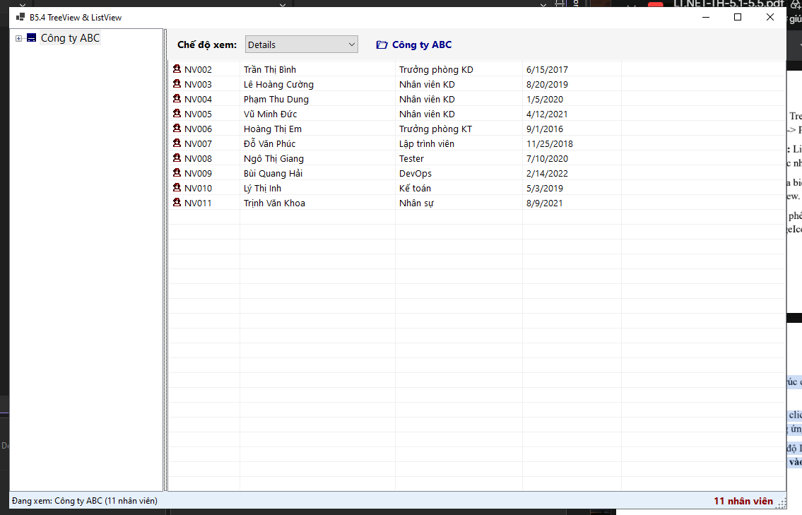
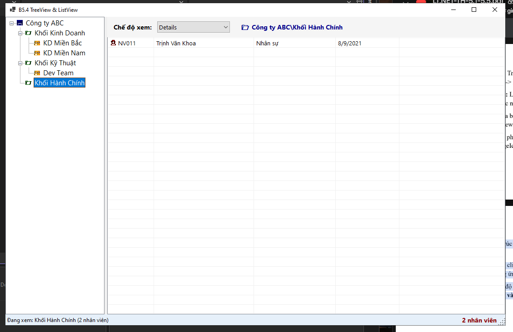
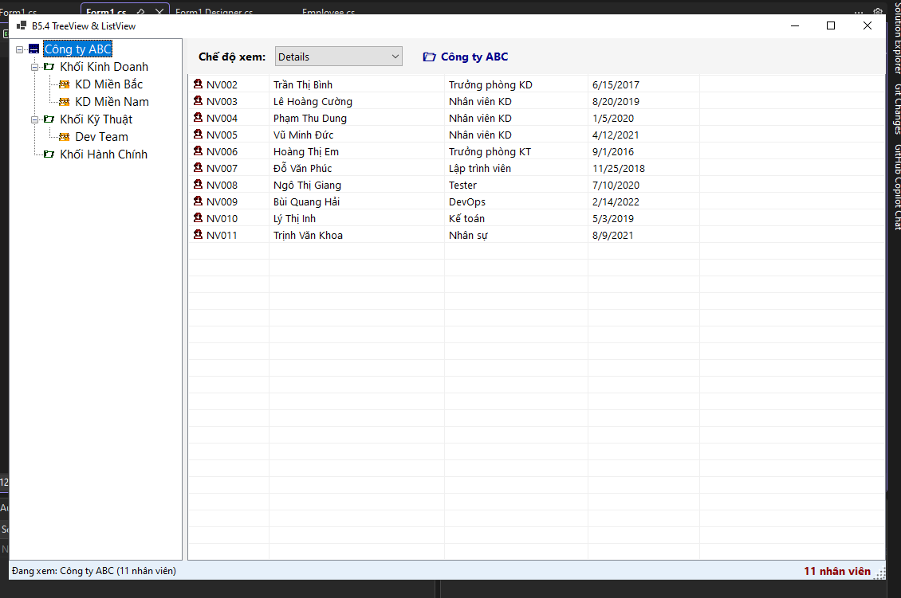
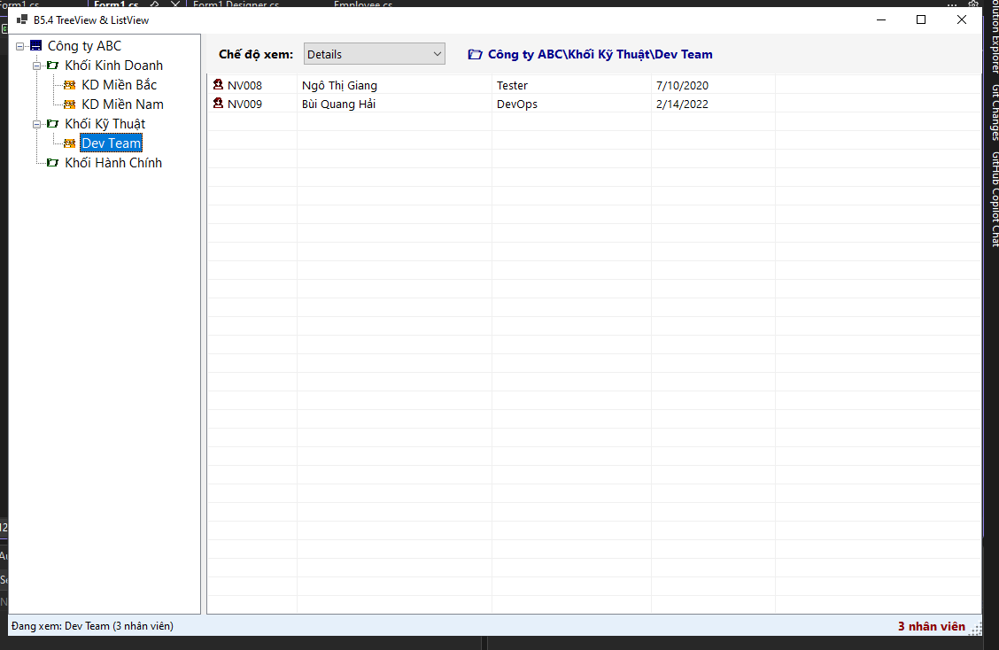
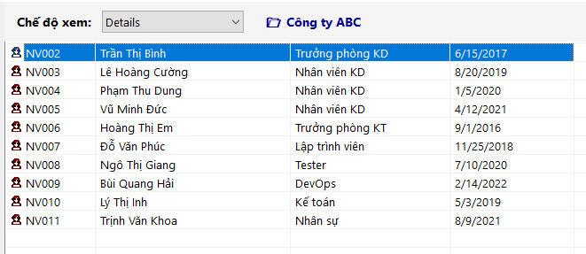

# BÁO CÁO BÀI TẬP

## THÔNG TIN SINH VIÊN
- **Họ và tên: Đặng Cao Thành Đạt**
- **Mã số sinh viên: 24810320215** 
- **Lớp: D19QTANM1** 
- **Tên môn học: Lập Trình.Net** 
- **Tên bài tập: BÀI 5.4: TRÌNH QUẢN LÝ TẬP TIN DẠNG CHUYÊN NGHIỆP
(TREEVIEW & LISTVIEW)** 

---

## KẾT QUẢ THỰC HÀNH

### 1. Ảnh màn hình Giao diện chính

### 2. Xây dựng cấu trúc cây dữ liệu mẫu cho TreeView khi khởi chạy ứng dụng.

### 3.1 Khi người dùng click chọn một Node trên TreeView, lọc danh sách nhân viên tương ứng thuộc Node đó và nạp vào ListView.

### 3.2 Khi người dùng click chọn một Node trên TreeView, lọc danh sách nhân viên tương ứng thuộc Node đó và nạp vào ListView.

### 4. ListView ở chế độ Details phải hiển thị rõ các cột: Mã NV, Họ Tên, Chức vụ, Ngày vào làm.
